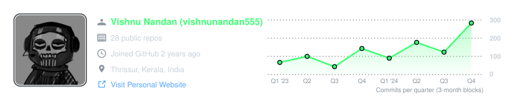
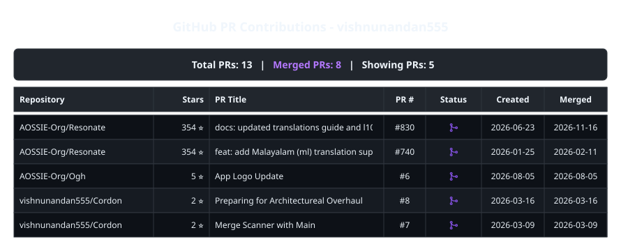

  <!-- TOP BANNER: Profile details, user bio, public repo count & quarterly commit activity chart -->
   
  <!-- ROW 1: RETRO TERMINAL (PART 1: Stats Summary with Active Days Ring & About Me) -->
   
  <!-- ROW 2: RETRO TERMINAL (PART 2: Streaks Waveform & Weekly Rhythm) -->
   
  <!-- ROW 3: CALENDAR & ACTIVITY (1-Year 3D Isometric Commit Calendar & Recent Activity) -->
   
  <!-- ROW 4: FOLLOW-UP & LEETCODE (Issues/PRs Follow-up Status & LeetCode Statistics) -->
   
  <!-- ROW 5: PULL REQUESTS TIMELINE (Dynamic PR Contributions Table) -->
  

<!--
======================================================================
ATTRIBUTIONS & CREDITS (Data, SVG Cards & Design Inspirations)
======================================================================
1. Top Profile Summary Details & Contribution Wave Graph:
   - Concept: https://github.com/tipsy/profile-summary-for-github
   - Card Generator: https://github.com/vn7n24fzkq/github-profile-summary-cards

2. DotMatrix Retro-Terminal Cards (Streaks, About, Weekly Rhythm, GitHub Stats Summary):
   - Repository: https://github.com/pedrocatalao/github-cool-readme

3. 1-Year IsoCalendar, Recent Activity, Issue & PR Follow-up, LeetCode Statistics:
   - Repository: https://github.com/lowlighter/metrics
   - Active Plugins: isocalendar, activity, followup, leetcode

4. GitHub PR Contributions Timeline Table:
   - Repository: https://github.com/f14XuanLv/github-pr-stats
======================================================================
-->
