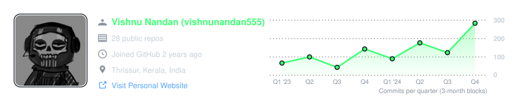

  <!-- TOP BANNER: Profile details, user bio, public repo count & quarterly commit activity chart -->
   
  <!-- ROW 1: RETRO TERMINAL (PART 1: Stats Summary with Active Days Ring & About Me) -->
   
  <!-- ROW 2: RETRO TERMINAL (PART 2: Streaks Waveform & Weekly Rhythm) -->
   
  <!-- ROW 3: CALENDAR & ACTIVITY (1-Year 3D Isometric Commit Calendar & Recent Activity) -->
   
  <!-- ROW 4: FOLLOW-UP & LEETCODE (Issues/PRs Follow-up Status & LeetCode Statistics) -->
   
  <!-- ROW 5: RECENT ACTIVITY BOARD HEADER -->
  

<!-- RECENT_CONTRIBUTIONS:START -->
| Type | Repository | Contribution | Status | Date |
| :---: | :--- | :--- | :---: | :---: |
|  | [**StabilityNexus/Zplit**](https://github.com/StabilityNexus/Zplit) | [#75 [FEATURE]: Enhancement of Onboarding Screen and Low ...](https://github.com/StabilityNexus/Zplit/issues/75) |  | Nov 16, 2026 |
|  | [**StabilityNexus/Zplit**](https://github.com/StabilityNexus/Zplit) | [#74 fix(website): update website favicon and icons with ...](https://github.com/StabilityNexus/Zplit/pull/74) |  | Nov 15, 2026 |
|  | [**StabilityNexus/Zplit**](https://github.com/StabilityNexus/Zplit) | [#76 feat(onboarding): decouple slide theming and upgrade...](https://github.com/StabilityNexus/Zplit/pull/76) |  | Nov 16, 2026 |
|  | [**AOSSIE-Org/Resonate**](https://github.com/AOSSIE-Org/Resonate) | [#738 DOC: Update TRANSLATIONS.md to reflect current auto-...](https://github.com/AOSSIE-Org/Resonate/issues/738) |  | Jan 25, 2026 |
|  | [**AOSSIE-Org/Resonate**](https://github.com/AOSSIE-Org/Resonate) | [#830 docs: updated translations guide and l10n config](https://github.com/AOSSIE-Org/Resonate/pull/830) |  | Jun 23, 2026 |
|  | [**StabilityNexus/Zplit**](https://github.com/StabilityNexus/Zplit) | [#73 [GOOD FIRST ISSUE] [MINOR BUG]: Website uses default...](https://github.com/StabilityNexus/Zplit/issues/73) |  | Nov 15, 2026 |
|  | [**johnfanv2/LenovoLegionLinux**](https://github.com/johnfanv2/LenovoLegionLinux) | [#647 [BUG] [LOQ 15IRX9 (NECN)] Rapid charge sysfs node mi...](https://github.com/johnfanv2/LenovoLegionLinux/issues/647) |  | Oct 28, 2026 |
<!-- RECENT_CONTRIBUTIONS:END -->

 

  <!-- FOOTER: Cyberpunk Status Signature & Terminal Connect Prompt -->
  

<!--
======================================================================
ATTRIBUTIONS & CREDITS (Data, SVG Cards & Design Inspirations)
======================================================================
1. Top Profile Summary Details & Contribution Wave Graph:
   - Concept: https://github.com/tipsy/profile-summary-for-github
   - Card Generator: https://github.com/vn7n24fzkq/github-profile-summary-cards

2. DotMatrix Retro-Terminal Cards (Streaks, About, Weekly Rhythm, GitHub Stats Summary):
   - Repository: https://github.com/pedrocatalao/github-cool-readme

3. 1-Year IsoCalendar, Recent Activity, Issue & PR Follow-up, LeetCode Statistics:
   - Repository: https://github.com/lowlighter/metrics
   - Active Plugins: isocalendar, activity, followup, leetcode
======================================================================
-->
