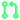

  <!-- TOP BANNER: Profile details, user bio, public repo count & quarterly commit activity chart -->
   
  <!-- ROW 1 & 2: RETRO TERMINAL (Seamless 2x2 Grid: Stats Summary, About Me, Streaks & Weekly Rhythm) -->
   
  <!-- ROW 3: CALENDAR & ACTIVITY (1-Year 3D Isometric Commit Calendar & Recent Activity) -->
   
  <!-- ROW 4: FOLLOW-UP & LEETCODE (Issues/PRs Follow-up Status & LeetCode Statistics) -->
   
  <!-- ROW 5: RECENT ACTIVITY BOARD HEADER -->
  

<!-- RECENT_CONTRIBUTIONS:START -->
| Item | Repository | Contribution | Created Date | Last Updated |
| :---: | :--- | :--- | :---: | :---: |
|  | [**StabilityNexus/.github**](https://github.com/StabilityNexus/.github) | [#9 Fix link to AI Usage Policy in PR template](https://github.com/StabilityNexus/.github/pull/9) | Nov 25, 2026 | Nov 25, 2026 |
|  | [**AOSSIE-Org/Info**](https://github.com/AOSSIE-Org/Info) | [#83 fix: resolve broken links across docs and corrected typos](https://github.com/AOSSIE-Org/Info/pull/83) | Nov 25, 2026 | Nov 25, 2026 |
|  | [**StabilityNexus/Zplit**](https://github.com/StabilityNexus/Zplit) | [#73 [GOOD FIRST ISSUE] [MINOR BUG]: Website uses default star...](https://github.com/StabilityNexus/Zplit/issues/73) | Nov 15, 2026 | Nov 24, 2026 |
|  | [**StabilityNexus/Zplit**](https://github.com/StabilityNexus/Zplit) | [#75 [FEATURE]: Enhancement of Onboarding Screen and Low Res A...](https://github.com/StabilityNexus/Zplit/issues/75) | Nov 16, 2026 | Nov 16, 2026 |
|  | [**StabilityNexus/Zplit**](https://github.com/StabilityNexus/Zplit) | [#74 fix(website): update website favicon and icons with offic...](https://github.com/StabilityNexus/Zplit/pull/74) | Nov 15, 2026 | Nov 16, 2026 |
|  | [**StabilityNexus/Zplit**](https://github.com/StabilityNexus/Zplit) | [#76 feat(onboarding): decouple slide theming and upgrade high...](https://github.com/StabilityNexus/Zplit/pull/76) | Nov 16, 2026 | Nov 16, 2026 |
|  | [**AOSSIE-Org/Resonate**](https://github.com/AOSSIE-Org/Resonate) | [#738 DOC: Update TRANSLATIONS.md to reflect current auto-gener...](https://github.com/AOSSIE-Org/Resonate/issues/738) | Jan 25, 2026 | Nov 16, 2026 |
|  | [**AOSSIE-Org/Resonate**](https://github.com/AOSSIE-Org/Resonate) | [#830 docs: updated translations guide and l10n config](https://github.com/AOSSIE-Org/Resonate/pull/830) | Jun 23, 2026 | Nov 16, 2026 |
<!-- RECENT_CONTRIBUTIONS:END -->

  <!-- FOOTER: Cyberpunk Status Signature & Terminal Connect Prompt -->
  

<!--
======================================================================
ATTRIBUTIONS & CREDITS (Data, SVG Cards & Design Inspirations)
======================================================================
1. Top Profile Summary Details & Contribution Wave Graph:
   - Concept: https://github.com/tipsy/profile-summary-for-github
   - Card Generator: https://github.com/vn7n24fzkq/github-profile-summary-cards

2. DotMatrix Retro-Terminal Cards (Streaks, About, Weekly Rhythm, GitHub Stats Summary):
   - Repository: https://github.com/pedrocatalao/github-cool-readme

3. 1-Year IsoCalendar, Recent Activity, Issue & PR Follow-up, LeetCode Statistics:
   - Repository: https://github.com/lowlighter/metrics
   - Active Plugins: isocalendar, activity, followup, leetcode
======================================================================
-->
